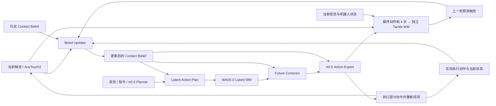

# TWAM — Contact-Belief World-Action Model

基于 π0.5 / WAVE-0 的触觉反馈研究代码。模型结合当前触觉、上一轮接触预测和实际执行动作，更新 Contact Belief，再修正未来表征并生成下一段动作。

本仓库从原工作区的 `contact-belief-wam` 整理而来，Python 包名仍为 `contact_belief_wam`，CLI 仍为 `cbwam`，旧 checkpoint 继续使用原来的接触预测结构；新的默认配置先独立训练触觉 WM，再训练视觉/接触模块与策略。



这是推理流程的简图；WM 同时读取当前视觉 latent 和机器人状态。用于下一轮反馈的触觉预期会根据最终动作前 k 步重新计算，在下一次匹配时间戳的观测到来后作为参考；训练目标中的真实未来触觉不会作为在线推理输入。详细连接与训练目标见 [architecture](docs/architecture.md)。

新代码从四个文件开始读：`train.py` 组织阶段与进程，`trainer.py` 运行单阶段训练，`data.py` 处理 WAVE-0 对齐数据，`serve.py` 维护在线反馈。旧的绝对动作数据/训练实现放在 `legacy/`，旧 `aligned_train.sh` 仅转发到 `train.sh`。

默认 `full` 顺序为 `tactile → stage1 → stage2`。`tactile` 只训练独立预测器，输入当前视觉/触觉、状态和真实动作前缀，输出冻结 AnyTouch2 的未来 latent；它不读取 belief 或未来视觉。触觉阶段按触觉验证误差选 checkpoint，并记录 persistence 和错误动作对照。后两阶段加载并冻结该预测器。`wave0_recovery` 跳过触觉阶段，保留原有 WAVE-0 两阶段目标。这里尚未增加带 blocked/normal 标签的 Belief 专项阶段。

旧耦合预测器的 checkpoint 不能直接当成独立触觉预训练权重；新配置需使用新的输出目录。实际操作见 [独立触觉训练](docs/tactile_training.md)。

## 目录

| 路径 | 内容 |
|---|---|
| `src/contact_belief_wam/` | 模型、belief 更新、未来修正、数据管线、训练、服务与仿真适配 |
| `configs/` | 独立触觉预训练、WAVE-0 两阶段配方、恢复采集配置 |
| `scripts/` | 环境准备、配置生成、训练、评测/仿真与审计入口 |
| `tests/` | 梯度、冻结、时间对齐、缓存、恢复训练与服务协议回归 |
| `vendor/wave0/` | 实际使用的 WAVE-0 / LeRobot 源码与本地 attention 修改 |
| `vendor/aligned_reference/` | 对照实现、8 任务统计、数据段边界及输入输出协议 |
| `docs/` | 架构、训练说明、历史工程记录及本次整理信息 |

数据、AnyTouch2 权重、π0.5/WAVE-0 checkpoint、环境、缓存和实验输出通过外部路径使用，不存入 Git。第三方来源见 [THIRD_PARTY_NOTICES.md](THIRD_PARTY_NOTICES.md)。

## 环境

使用 Python 3.10、PyTorch 2.7.1 + CUDA 12.6 和指定提交的 Transformers。以下命令安装依赖，不会训练模型：

```bash
bash scripts/bootstrap_env.sh --python python3.10
export CBWAM_ROOT="$PWD"
export PYTHONPATH="$CBWAM_ROOT/src:$CBWAM_ROOT/vendor/wave0/src:${PYTHONPATH:-}"
```

Transformers 由脚本按 `vendor/SOURCE.json` 中的固定 commit 和 SHA-256 下载；不能用普通 PyPI 版本代替。离线时先运行 `python scripts/prepare_transformers.py --archive /path/to/source.tar.gz`，再使用原有 wheelhouse 安装。

已有工作区环境时可继续使用其 Python，无需重装；仍需设置上面的 `CBWAM_ROOT` 和 `PYTHONPATH`，确保导入本仓库代码。

## 连接现有数据与权重

假设原工作区为 `/zhe_li/tactile-wam`，其下已有 `UniVTAC/`、`AnyTouch2/`、模型权重以及 `contact-belief-wam/data/`：

```bash
export TWAM_ROOT=/zhe_li/tactile-wam
export CBW_PYTHON="$TWAM_ROOT/contact-belief-wam/.venv/bin/python"
"$CBW_PYTHON" scripts/configure_workspace.py --workspace "$TWAM_ROOT"
```

这只生成被 Git 忽略的 `configs/workspace.local.yaml`。它引用已有原始数据、触觉缓存和初始化权重，将新输出写入本仓库 `data/` 与 `runs/`，不会移动或修改原实验。换机器后先检查该配置中的所有路径；权重名中的 `local_debug` 是历史转换目录名，并非 debug 训练产物。

该工具假定原工作区已经完成 800 条原始轨迹和 100 条恢复轨迹的 manifest/cache 准备；全新数据准备见 [历史工作区说明](docs/legacy_workspace_readme.md) 和 [恢复采集](docs/recovery.md)。这些历史文档的路径和进展只代表对应开发阶段，不是新仓库的默认路径或当前结果。

## 当前推荐入口

```bash
# 根据已准备好的原始 manifest/cache 生成本仓库的 aligned 输入
bash scripts/train.sh prepare --config configs/workspace.local.yaml

# 仅查看分卡计划，不启动训练
bash scripts/train.sh train --config configs/workspace.local.yaml --variant full --plan

# CPU 回归测试，不加载完整权重或启动仿真
"$CBW_PYTHON" -m pytest -q tests
```

正式训练和 bounded debug 的参数见 [aligned_training.md](docs/aligned_training.md)，在此 checkout 中使用 `scripts/train.sh` 和生成的本地配置。旧配方及旧绝对动作 checkpoint 不用于续训新的 aligned 版本。`full` 是完整方法，`wave0_recovery` 使用相同恢复数据训练独立的对照 teacher。

评测需要另外可用的 UniVTAC / Isaac Sim 环境，设置 `TWAM_ROOT`（外部资产根目录）与 `SIM_PREFIX`（仿真 Python 环境）。本仓库已包含 `scripts/sim-env.sh`，不要求从旧策略目录加载仿真启动脚本。示例：

```bash
"$CBW_PYTHON" -m contact_belief_wam eval \
  --task insert_hole --checkpoint /path/to/trained/export/final \
  --output "$CBWAM_ROOT/outputs/eval/insert_hole" \
  --seeds 1000000 --device cuda --port 18781
```

## 当前状态与限制

下述正式作业记录属于独立触觉改动之前的版本；新版本尚未完成正式训练。

- 已实现：AnyTouch2 接入、递归 belief、future correction、接触预测、恢复数据训练、独立触觉预训练、WAVE-0 两阶段训练和在线推理接口；已有 smoke 与回归检查。
- 最近的 `aligned-wave0-fast-v1/full` 正式作业已完成 Stage 1（5,000 步），Stage 2 因多卡 NCCL 同步超时中止，尚无完整方法的正式闭环成功率结果。本次整理不修复该训练故障，也不启动训练。
- 尚未实现独立的学习型任务进度/恢复价值预测头；现有受阻检测与恢复采集规则不能等同于该模块。
- 基础策略是 WAVE-0 的 PyTorch π0.5 路线；并未把原来按任务微调过的 JAX checkpoint 自动迁移进来。

源码来源与未改动模型文件的哈希见 [SOURCE_SNAPSHOT.json](docs/SOURCE_SNAPSHOT.json)。历史 debug 记录不是正式性能结论。
